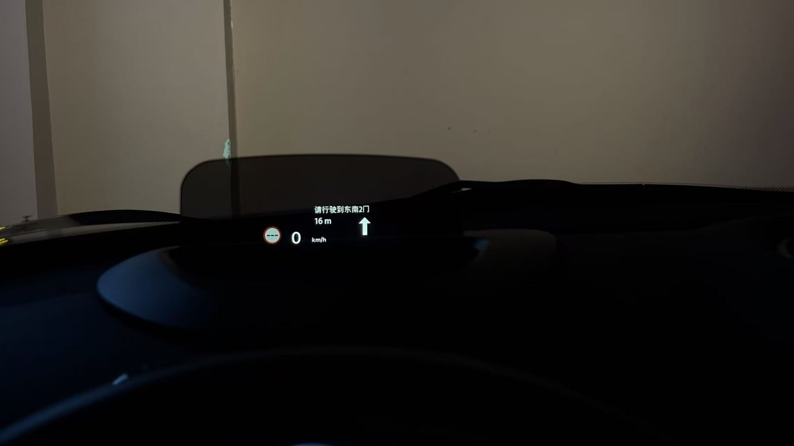
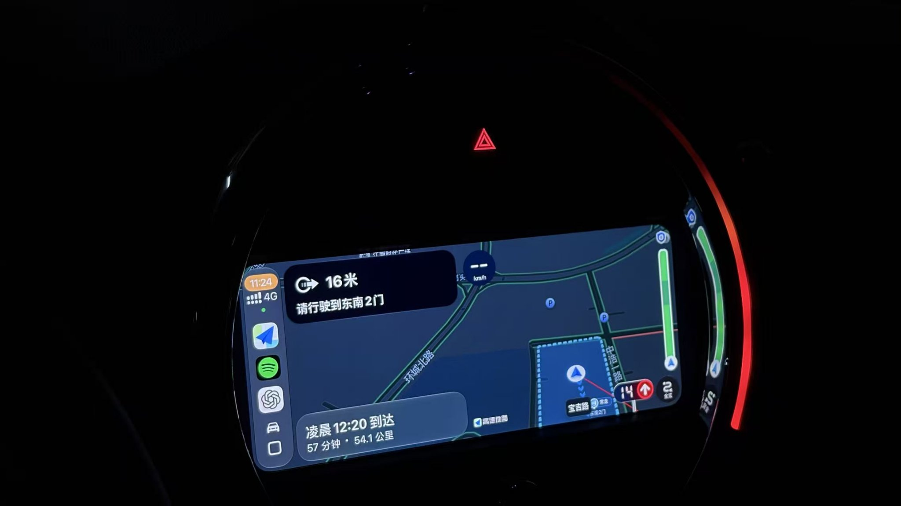
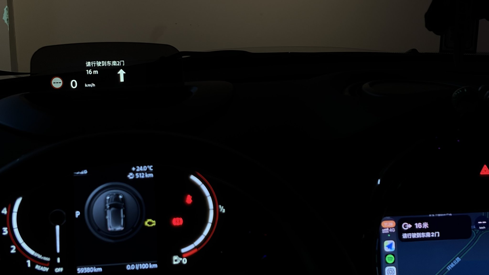
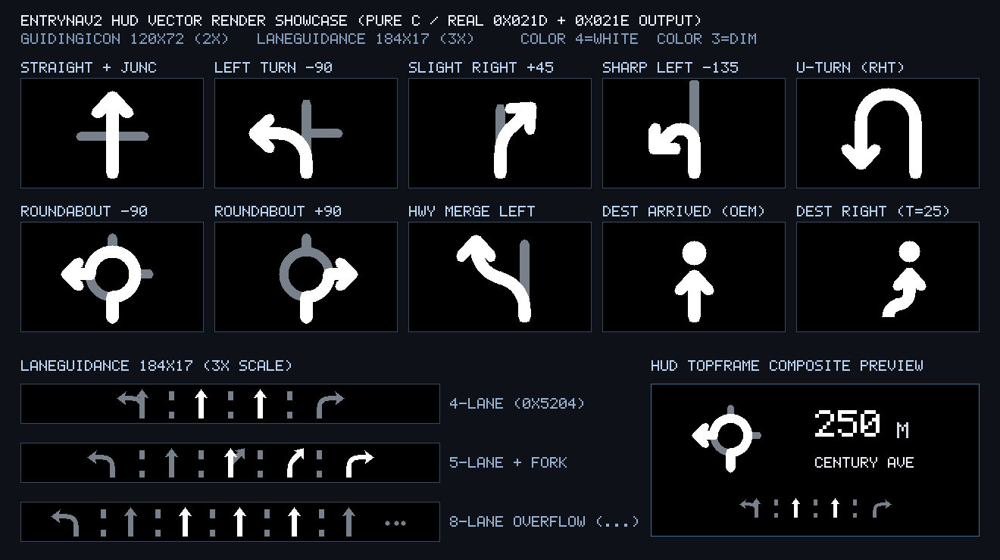

# EntryNav2 CarPlay → OEM Optical MOST HUD (`hud-port`)

**Language / 语言：** [简体中文](README.md) | [English](README.en.md)

> **If this project helped or inspired you, please consider giving it a Star ⭐!**
>
> **Original Work & Noncommercial License**: All pure-C core code in this repository is 100% original work written from scratch via real-vehicle captures and protocol analysis. Permitted for personal learning, research, and noncommercial use only — **commercial use is strictly prohibited** (see [LICENSE](LICENSE)).

Real-time **iPhone CarPlay Route Guidance** (vector turn/roundabout/destination icons, exit angles & junction branches, distance/units, UTF-16BE street names, and lane guidance) rendered onto the factory windshield Head-Up Display of **MINI / BMW EntryNav2** head units over MOST `FBlock 0x82 / Inst 0x00` (`HUDTerminal`).

> This repository contains only the pure-C head-unit core (`carplay-shim.so`, `hud_bridge`, `hud_probe`, `rgd_listen`, renderer, unit tests, and `systemd` templates). It excludes the Android companion APK and proprietary head-unit libraries.

---

## 1. Real-Vehicle Photos & Vector Render Showcase

| Optical HUD Close-Up (CJK + Distance + Arrow) | Center CarPlay Navigation Sync | Cockpit View (HUD + Cluster + Center) |
| :---: | :---: | :---: |
|  |  |  |



*Rasterized directly from real `0x021D` polygon and `0x021E` circle/arc draw commands emitted by `hud_render.c` — zero static bitmap assets.*

---

## 2. Principles & Implementation

The stack directly follows the **Apple iAP2 Route Guidance specification** and **EntryNav2 factory libraries** (`libNmeSDK.so`, `libVMostAdapter.so`, `libvmostclient.so.1`, `libvmostcpp.so.1`):

### 1. iAP2 Protocol Injection & Non-Blocking Capture (`carplay-shim.so`)
- **Component Declaration & Native Subscribe**: Loaded via `LD_PRELOAD` into `/usr/local/bin/CARPLAY`, `NmeIAP2Message::Encode` injects `0x001E RouteGuidanceDisplayComponent` (`0x0000..0x0008` in iAP2 order) plus `0x0006` (`0x5200/0x5203`) and `0x0007` (`0x5201/0x5202/0x5204`) into `0x1D01` (`IdentificationInformation`). Upon `0x1D02 IdentificationAccepted`, a background worker calls factory `ICinemoIAP_StartRouteGuidanceUpdates` to activate guidance updates.
- **Two-Process Decoupling**: `CARPLAY` is guarded by `WatchdogSec=75` and must never block. `carplay-shim.so` pushes raw `0x52xx` frames through a **32-slot × 4096B `pthread_mutex_trylock` ring buffer** to `/tmp/carplay_rgd.sock`, leaving parsing and MOST I/O to the standalone `hud_bridge` daemon.

### 2. Native Optical MOST HUD Vector Rendering (`hud_bridge` + `hud_render.c`)
Connects to `/var/run/vmost_sockstream` (`MHP 0xF1/0x05`) and `FBlock 0x82 / Inst 0x00` (`HUDTerminal`), consuming full `0x5201` / `0x5202` / `0x5204` telemetry:
- **Continuous-Angle Geometry & Junction Context**: Rotates turns smoothly by exact `ExitAngle (-180°..+180°)` with constant-radius circular fillets, `Open V-Chevron` arrowheads, and dimmed (`HUD_COLOR_DIM = 3`) `JunctionElementAngles[]` non-navigated side roads.
- **Hardware `0x021E` Arcs & Seamless `0x021D` Polygons**: Aligns strictly with EntryNav2's verified `0x021E` coordinates (`0 = 3 o'clock counter-clockwise`, `0.1°` units) for turn fillets, roundabout base rings (`HUD_CIRCLE_FULL`) and active arcs, U-turn arches, tangent-matched **S-curves** (`HUD_CIRCLE_ARC`) on highway lane changes / offset arrivals, and solid arrival markers (`HUD_CIRCLE_FILLED`), paired with `0x021D` polygons (38–58 vertices verified cleanly on hardware).
- **OEM `DestinationMan`-Style Arrival**: Mirrors `libVMostAdapter.so` (`0x021E HUD_CIRCLE_FILLED` dot + upward arrow) for `ManeuverType = 10/12/24/25/27` and enforces a `RouteState = 2 (Arrived)` fallback (clears stale lanes and prioritizes `DestinationName`).
- **Adaptive Lane Strip & UTF-16BE CJK Text**: `1.LaneGuidance` (`184×17`) draws 2–8 lanes with multi-direction arrows and highlights; `hud_encode_most_string()` follows `libvmostcpp.so.1.6.0` `writeMOSTString` (`0x01` ASCII, `0x00` + **UTF-16 Big-Endian** + `0x0000` for CJK/non-ASCII).
- **Session Guarding**: `FNV-1a` frame diffing + double-buffered `SwitchVisibility (0x020E)`, 15s active keepalive, `2500ms` reroute debounce, and 5s automatic yield on factory `ErrorAck (0x0F)`.

---

## 3. Data Flow & Repository Layout

```text
┌───────────────────┐     iAP2 (0x1D01/0x1D02/0x5200..0x5204)     ┌──────────────────────────────┐
│   iPhone CarPlay  │ ──────────────────────────────────────────► │  /usr/local/bin/CARPLAY      │
│ (Apple/Amap/etc.) │ ◄────────────────────────────────────────── │  + LD_PRELOAD carplay-shim.so│
└───────────────────┘   0x1D01 +0x001E & 0x5200 StartRGD          └──────────────┬───────────────┘
                                                                                 │
                                           trylock ring + worker thread          │ SOCK_DGRAM (non-blocking)
                                           /tmp/carplay_rgd.sock (chmod 0666)    ▼
┌───────────────────┐     MOST 0x82/0x00 + MHP (0xF1/0x05)        ┌──────────────────────────────┐
│  OEM Optical HUD  │ ◄────────────────────────────────────────── │  hud_bridge + hud_render.c   │
│ (FBlock 0x82/00)  │   /var/run/vmost_sockstream (libvmostclient)│  (State machine + vector/arc)│
└───────────────────┘                                             └──────────────────────────────┘
```

```text
hud-port/
├── build.sh                          # Host unit tests + Zig ARMv7 cross-build + ABI check
├── docs/                             # Real-vehicle photos & vector render showcase
├── include/
│   ├── iap2_rgd.h                    # iAP2 0x1D01 / 0x5200..0x5204 TLV constants & BE helpers
│   ├── vmost_api.h                   # libvmostclient.so.1 structs & 0x82 HUDTerminal IDs
│   └── hud_render.h                  # RgdState state machine, draw commands & frame structs
├── src/
│   ├── carplay_shim.c                # Non-blocking LD_PRELOAD iAP2 hook for CARPLAY
│   ├── hud_bridge.c                  # MOST/MHP session daemon: double-buffering, keepalive & diffing
│   ├── hud_render.c                  # iAP2 state machine, vector/0x021E renderer & UTF-16BE encoder
│   ├── hud_probe.c                   # Read-only MOST 0x82/0x00 probe & 8s standalone draw test
│   └── rgd_listen.c                  # Live /tmp/carplay_rgd.sock iAP2 decoder (--redact supported)
├── tests/test_hud_render.c           # Host-side unit tests (-Wall -Wextra -Werror)
└── systemd/                          # RAM (/run) & persistent (/etc, 3-crash fallback) templates
```

---

## 4. Verified Platform & App Compatibility

| Item | Specification |
|---|---|
| **Vehicle / Head Unit** | 2021 MINI F56 JCW · **EntryNav2** (TI Jacinto 6 ARMv7 Cortex-A15 + NEON, build `202005181837`) |
| **OS / ABI** | `Linux 3.12.25-FR21.0`, `eglibc 2.15` (`GLIBC_2.4` / `2.7`, `arm-linux-gnueabihf`) |
| **HUD Surfaces** | MOST `FBlock 0x82 / Inst 0x00`: `TopFrame` + `Distance/Unit/ComingStreet` + `GuidingIcon (120×72)` + `LaneGuidance (184×17)` |
| **Navigation Apps** | **Apple Maps** (full incl. `0x5204` lanes) · **Amap** (arrows/distance/CJK roads; app omits `0x5204`) · **Baidu Maps** (supported) |

---

## 5. Cross-Compilation & Deployment

### Build & Unit Test
Requires [Zig](https://ziglang.org/) (tested `0.17.1`) and `libvmostclient.so.1.6.0` + `libvmost.so.1.6.0` pulled from your head unit's `/usr/local/lib/` (kept local only):

```bash
export RUNTIME_LIB=/path/to/entrynav2/usr/local/lib
./build.sh
```

### Head-Unit Deployment
> **Safety Rule**: **Never power off the ignition while `/` is mounted read-write (`rw`).** Validate with the RAM-only setup first.

- **Option A: RAM-Only Testing (Reverts completely on reboot)**

```sh
scp build/hud_bridge build/carplay-shim.so build/hud_probe build/rgd_listen root@169.254.1.0:/tmp/
chmod 0755 /tmp/hud_bridge /tmp/carplay-shim.so /tmp/hud_probe /tmp/rgd_listen
cp systemd/hud-bridge.service /run/systemd/system/hud-bridge.service
mkdir -p /run/systemd/system/CARPLAY.service.d
cp systemd/CARPLAY.service.d/hud-shim.conf /run/systemd/system/CARPLAY.service.d/hud-shim.conf
systemctl daemon-reload && systemctl start hud-bridge.service && systemctl restart CARPLAY.service
```

- **Option B: Guarded Persistent Install**
  `/var/local` is mounted `noexec`. Place binaries under `/opt/hud-port/`, install `systemd/hud-bridge-persist.service` and `systemd/CARPLAY.service.d/hud-shim-persist.conf` (includes `/tmp/.hud_shim_tries` **3-crash fallback** to stock `CARPLAY`) under `/etc/systemd/system/`, then run `sync && mount -o remount,ro /` and verify `/` is `ro`.

---

## 6. Copyright & Noncommercial License

- **Copyright**: `Copyright (c) 2026 cerary. All rights reserved.`
- **Originality**: All pure-C source files in this repository are **original work written from scratch** by the author based on live vehicle captures and binary analysis, with zero third-party code or static image assets; `libvmostclient.so.1` and `libvmost.so.1` belong to your own head unit and are not distributed here.
- **License**: Licensed under **[PolyForm Noncommercial License 1.0.0](LICENSE)**:
  - ✅ **Permitted**: Personal study, research, inspection, noncommercial personal vehicle use, and noncommercial forks/modifications (must retain the original copyright notice and `LICENSE`).
  - ❌ **Commercial Use Prohibited**: Commercial use, bundling, paid retrofit/coding services, or commercial hardware/software distribution is strictly prohibited.

> **If you like this project, please drop a Star ⭐ — it really helps and motivates continued work!**
