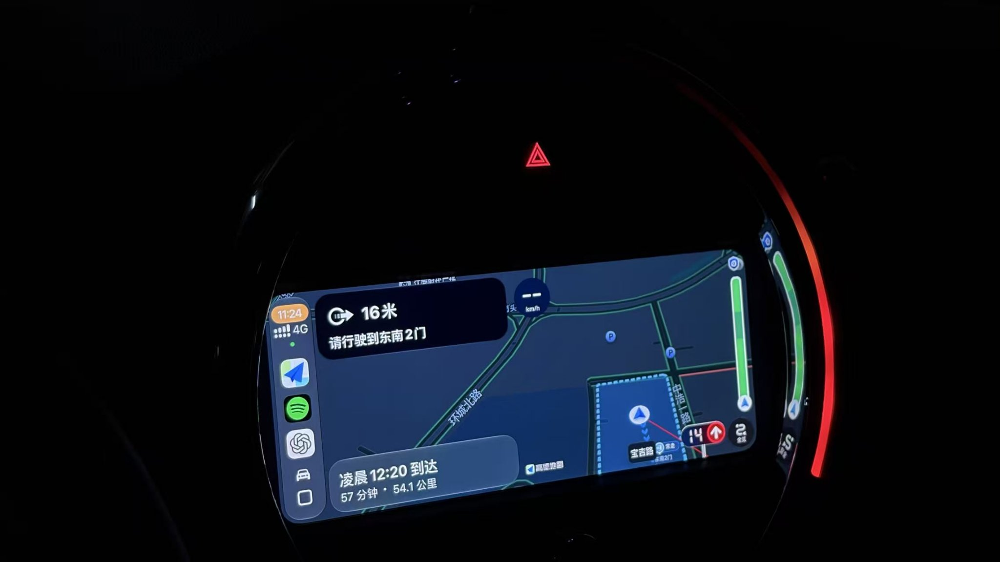
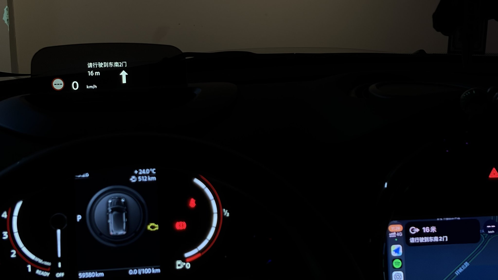

# EntryNav2 CarPlay → 原厂光学 MOST HUD 实时导航投射（`hud-port`）

**语言 / Language：** [简体中文](README.md) | [English](README.en.md)

> **如果这个项目对你有帮助或启发，欢迎点击右上角点个 Star ⭐ 支持一下！**
>
> **原创声明与非商业许可**：本项目全部纯 C 核心代码均由作者独立抓包分析与从零编写，仅允许个人学习、技术研究与非商业自用，**严禁用于任何商业用途**（详情见文末与 [LICENSE](LICENSE)）。

将 iPhone **CarPlay 实时导航引导（矢量转向/环岛/终点图标、出口角度与岔路、距离/单位、中文/英文路名、车道引导）** 实时投射到 **MINI / BMW EntryNav2** 主机的原厂光学风挡抬头显示（MOST `FBlock 0x82 / Inst 0x00` `HUDTerminal`）。

> 本仓库仅包含车机端纯 C 核心工程（`carplay-shim.so`、`hud_bridge`、`hud_probe`、`rgd_listen`、渲染器、单元测试与 systemd 部署模板），不含 Android 调试端 APK 与车机专有闭源库。

---

## 一、实车效果与矢量渲染预览

| 原厂光学 HUD 特写（中文路名 + 距离 + 箭头） | 中控 CarPlay 同步导航画面 | 驾驶位全景（HUD + 仪表 + 中控） |
| :---: | :---: | :---: |
|  |  |  |


*上图由 `hud_render.c` 真实输出的 `0x021D` 多边形与 `0x021E` 圆弧/圆点指令直接光栅化生成，无任何静态图片素材。*

---

## 二、设计原理与核心优势（基于 Apple iAP2 规范与 EntryNav2 原厂库）

本项目读取 iPhone 发出的 **Apple iAP2 Route Guidance** 导航字段，并用 **EntryNav2 原厂 MOST HUD** 的绘图指令显示。和先把动作转成少数固定图标的方案不同，同样是“右转”，HUD 仍能区分路口的实际出口角度，也能画出不该走的岔路。

### 1. 直接使用 Apple iAP2 导航字段
- **标准组件声明与主动订阅**：在 `NmeIAP2Message::Encode` 拦截 `0x1D01` (`IdentificationInformation`)，严格按 iAP2 规范顺序构造 `0x001E RouteGuidanceDisplayComponent`（`0x0000..0x0008`）并补充 `0x0006` (`0x5200/0x5203`) 与 `0x0007` (`0x5201/0x5202/0x5204`)；收到 `0x1D02 IdentificationAccepted` 后调用车机原生 `ICinemoIAP_StartRouteGuidanceUpdates`（已核对 `libNmeSDK.so` / `libNmeBaseClasses.so` / `libNmeVfs.so`）激活手机端实时引导。
- **路口和车道几何**：`0x5201` 提供路线状态、路名、目的地与距离；`0x5202` 提供 `ManeuverType`、`ExitAngle`（−180° 到 +180°）、`JunctionType`、`JunctionElementAngles[]` 与 `DrivingSide`；`0x5204` 提供各车道的位置、状态、可行方向及高亮方向。渲染器使用地图 App 实际下发的字段，不会从视频中推测缺失的车道。

### 2. 基于 EntryNav2 原厂库的原生光学 MOST HUD 矢量渲染
经逆向核验原厂 `libVMostAdapter.so`、`libvmostclient.so.1.6.0` 与 `libvmostcpp.so.1.6.0`，`hud_render.c` 直接生成 `HUDTerminal` (`FBlock 0x82 / Inst 0x00`, `MHP 0xF1/0x05`) 原生矢量指令：
- **自由角度平滑矢量化**：依据 `ExitAngle` 连续旋转主路径，结合等半径圆弧倒角与 `Open V-Chevron` 开口箭头，并将 `JunctionElementAngles[]` 绘制为暗色（`HUD_COLOR_DIM = 3`）非行进岔路底图。
- **原生 `0x021E` 硬件圆弧与 `0x021D` 单块无缝多边形**：严格对齐原厂 `0x021E` 坐标系（`0 = 3 点钟逆时针`、`0.1°` 精度），用于转向圆角、环岛外环（`HUD_CIRCLE_FULL`）与路径高亮、掉头、高速变道与偏置终点的双切圆 **S 弯**（`HUD_CIRCLE_ARC`）及终点圆标（`HUD_CIRCLE_FILLED`）；辅助分叉与箭头头部采用 `0x021D` 多边形（实测稳定支持 38~58 顶点），消除拼接接缝。
- **车道引导**：`0x5204` 的车道位置、状态和分支角决定 `1.LaneGuidance` 上的箭头；白色指示可用或推荐方向，灰色保留其他方向。它不是从中控画面裁出的一条图片。
- **原厂 `DestinationMan` 风格到达终点与状态兜底**：对齐 `libVMostAdapter.so` 到达渲染规范，以 `0x021E HUD_CIRCLE_FILLED` 实心圆标配指向圆点的向上箭头呈现；同时支持 `ManeuverType = 10/12/24/25/27`（含左/右偏置 S 弯）及 `RouteState = 2 (Arrived)` 强制兜底（自动隐藏旧车道条并优先展示 `DestinationName`）。
- **原生中文/CJK 编码（`UTF-16BE`）**：遵循 `libvmostcpp.so.1.6.0` `writeMOSTString` 规则，纯 ASCII 走 `0x01` 编码，含中文或非 ASCII 自动编码为 `0x00` + **UTF-16 Big-Endian** + `0x0000`，在原厂风挡 HUD 清晰显示高德/Apple/百度中文路名与目的地。
- **刷新与恢复**：`hud_bridge` 用 `FNV-1a` 比较整帧内容，以双缓冲交换前后画布；静止画面每 15 秒保活。短暂的无路线状态有 2.5 秒防抖，HUD 返回错误时会释放显示会话并等待 5 秒。

---

## 三、已验证目标车型与车机平台规格

| 项目 | 实车验证版本 / 规格 |
|---|---|
| **车辆** | 2021 MINI F56 JCW（F 底盘，配原厂光学风挡 HUD） |
| **主机平台** | **EntryNav2**（`xse-j6-apn-entryevo`，TI Jacinto 6 ARMv7 Cortex-A15 + NEON，hard-float） |
| **Linux 内核** | `Linux 3.12.25-FR21.0` |
| **车机固件构建** | `202005181837` |
| **C 运行库 ABI** | `eglibc 2.15`（符号版本需兼容 `GLIBC_2.4` / `GLIBC_2.7`，`arm-linux-gnueabihf`） |
| **原厂 HUD 通道** | 光学 MOST 总线 `FBlock 0x82` (`HUDTerminal`), `Inst 0x00`, `Dev 0x0101` |
| **HUD 画布规格** | `TopFrame` 容器 + `Distance`/`Unit`/`ComingStreet` 文本区 + `1.GuidingIcon` (`120×72`, 双缓冲) + `1.LaneGuidance` (`184×17`, 双缓冲) |
| **CarPlay 服务** | Cinemo `/usr/local/bin/CARPLAY`（`User=carplay` UID `1081`, `WatchdogSec=75`, `/var/run/vmost_sockstream`） |
| **持久化限制** | `/var/local` (`/dev/mmcblk0p2`) 为 `noexec,nosuid,nodev` 挂载，不可执行二进制；持久化须使用独立受控目录（如 `/opt/hud-port/`）与 `/etc/systemd/system/` |

---

## 四、整体架构与实时数据流

```text
┌───────────────────┐     iAP2 (0x1D01/0x1D02/0x5200..0x5204)     ┌──────────────────────────────┐
│   iPhone CarPlay  │ ──────────────────────────────────────────► │  /usr/local/bin/CARPLAY      │
│ (Apple地图/高德等) │ ◄────────────────────────────────────────── │  + LD_PRELOAD carplay-shim.so│
└───────────────────┘   0x1D01 注入 0x001E + 0x5200 StartRGD      └──────────────┬───────────────┘
                                                                                 │
                                           trylock 环形队列 + 后台线程            │ SOCK_DGRAM (非阻塞)
                                           /tmp/carplay_rgd.sock (chmod 0666)    ▼
┌───────────────────┐     MOST 0x82/0x00 + MHP (0xF1/0x05)        ┌──────────────────────────────┐
│ 原厂光学风挡 HUD   │ ◄────────────────────────────────────────── │  hud_bridge + hud_render.c   │
│ (FBlock 0x82/00)  │   /var/run/vmost_sockstream (libvmostclient)│  (状态机 + 矢量/圆弧渲染)     │
└───────────────────┘                                             └──────────────────────────────┘
```

### 为什么需要 `carplay-shim.so` + `hud_bridge` 两段式解耦？
- `/usr/local/bin/CARPLAY` 以普通用户 `carplay` (UID 1081) 运行，受 `WatchdogSec=75` 看门狗监控，**绝不能在 Cinemo iAP2 接收线程内执行阻塞操作或直接操作 MOST 总线**。
- `carplay-shim.so` 只负责组件声明、订阅与报文复制。接收线程用 `pthread_mutex_trylock` 尝试入队；锁忙或队列满就放弃这一份副本，不等 HUD。后台线程用非阻塞 Unix 数据报将副本发给 `hud_bridge`，因此桥接进程未启动或重启时不会拖住车机上的 CarPlay 接收回调。

---

## 五、目录结构与核心模块说明

```text
hud-port/
├── build.sh                          # Zig 交叉编译脚本 + 主机单元测试 + ABI 校验
├── docs/                             # 实车照片与矢量渲染预览
├── include/
│   ├── iap2_rgd.h                    # iAP2 0x1D01 / 0x5200..0x5204 TLV 常量与大端读写辅助
│   ├── vmost_api.h                   # EntryNav2 libvmostclient.so.1 结构体与 0x82 HUDTerminal 功能码
│   └── hud_render.h                  # RgdState 状态机、矢量多边形/文本帧结构定义
├── src/
│   ├── carplay_shim.c                # CARPLAY 进程 LD_PRELOAD 非阻塞 iAP2 钩子
│   ├── hud_bridge.c                  # 主桥接守护进程：MHP/MOST 会话管理、保活与热渲染
│   ├── hud_render.c                  # iAP2 状态机、硬件圆弧与多边形渲染、UTF-16BE 编码
│   ├── hud_probe.c                   # MOST 0x82/0x00 只读探测 / 8 秒独立画图自检工具
│   └── rgd_listen.c                  # /tmp/carplay_rgd.sock 实时抓包解码器（支持 --redact 脱敏）
├── tests/
│   └── test_hud_render.c             # 主机端单元测试（-Wall -Wextra -Werror）
└── systemd/
    ├── hud-bridge.service            # hud_bridge 独立 systemd 服务模板
    ├── hud-bridge-persist.service    # 持久化桥接服务模板
    └── CARPLAY.service.d/
        ├── hud-shim.conf             # 内存态 (/run) 临时注入模板
        └── hud-shim-persist.conf     # 持久化 (/etc) 带 3 次崩溃自愈回退模板
```

### 各模块详细职责

#### 1. [`src/carplay_shim.c`](src/carplay_shim.c) → `carplay-shim.so`
通过 `LD_PRELOAD` 注入 `/usr/local/bin/CARPLAY`（构造函数校验 `/proc/self/exe` 仅对 `CARPLAY` 生效）：
- **符号 Hook**（已对固件 `202005181837` 的 `libNmeSDK.so` / `libNmeBaseClasses.so` 验证）：
  - `CinemoCreateIAP`：捕获 `ICinemoIAP*` 实例指针。
  - `NmeIAP2Message::Encode(NmeArray<uint8_t>&)`：拦截 `0x1D01` (`IdentificationInformation`)，自动追加：
    - `0x0006 MessagesSentByAccessory`：`0x5200` (`StartRouteGuidanceUpdates`)、`0x5203` (`StopRouteGuidanceUpdates`)；
    - `0x0007 MessagesReceivedFromDevice`：`0x5201`、`0x5202`、`0x5204`；
    - `0x001E RouteGuidanceDisplayComponent`（动态分配唯一 `ComponentID`，声明路口/路名/动作长度与车道容量 `MaxLaneGuidanceStorageCapacity = 8`）。
  - `NmeIAP2Message::Decode(const uint8_t*, int)`：捕获 `0x1D02`、`0x1D03` 与所有 `0x52xx` 报文：
    - 收到 `0x1D02 IdentificationAccepted` 后由后台线程调用 `ICinemoIAP_StartRouteGuidanceUpdates(iap, 1, &comp_id)`（若 2.5s 内未收到 `0x52xx` 会自动补发一次刷新）。
    - 采用 **32 槽 × 4096B `pthread_mutex_trylock` 环形缓冲区** 将原始报文交给后台线程发送至 `/tmp/carplay_rgd.sock`，**绝不阻塞解码线程**。

#### 2. [`src/hud_render.c`](src/hud_render.c) & [`include/hud_render.h`](include/hud_render.h)
纯 C 状态机与矢量渲染器。转向和车道图标由导航数据实时生成，画面由多边形、圆弧和文本组成，不依赖静态位图。
- **状态机与防抖**：
  - 支持 `route_state` `1/2/5/6` 及带有效转向的 `3/4`；
  - `2500ms` 重算路防抖（`REROUTE_DEBOUNCE_MS`）：短暂 `route_state=0` 不闪烁清屏，超时后才调用 `rgd_state_reset_route()`；收到 `0x5203` 立即清屏；
  - 自动过滤 `0xFFFFFFFF` 无效距离哨兵值，支持公制（`m`/`km`）与英制（`ft`/`yd`/`mi`）格式化。
- **矢量多边形与 `0x021E` 原生圆弧（`HUD_MAX_POLY_PTS = 64`）**：
  - 经对车机原厂 `libVMostAdapter.so` 的 `0x021D`（`ImageAddPolygon`）与 `0x021E`（`ImageAddCircle`）核查，`0x021D` 的 `nPts` 为 `uint8_t`（上限 255 点），EntryNav2 实车稳定支持单块 38~58 顶点连续填充多边形。
  - **普通转向**：进出路段之间用等半径硬件圆弧过渡；半径和切点随出口角度调整，`JunctionElementAngles[]` 提供灰色的其他岔路。
  - **掉头**：两段直杆由一条 `0x021E` 上半圆连接；左、右掉头镜像排列，半圆都从 3 点钟沿上侧画到 9 点钟。
  - **环岛**：灰色完整圆环和未选出口先画；白色进环直杆、选中圆弧、出环直杆与开口箭头随后叠加。`ExitAngle` 决定出口，`DrivingSide` 决定从哪一侧绕行。
  - **高速变道（`52/53`）与到达终点（`10/12/24/25/27` / `route_state=2`）**：变道与左/右偏置终点使用 `0x021E HUD_CIRCLE_ARC` 双切圆 S 弯实现无锯齿过渡；终点采用原厂 `GI: DestinationMan` 风格（`0x021E HUD_CIRCLE_FILLED` 实心圆点 + 向上箭头）。
- **`1.LaneGuidance`（`184×17`）车道条**：
  - 解析 `0x5204` 各车道的 `position`、`status`（0=不可用灰、1=可用白、2=推荐白）、多方向 `angles[]` 与 `highlighted_angle` 现场绘制；兼容未下发 `0x0012` 显隐标志时的索引兜底显示。
  - 这版使用独立的车道画布。最多直接显示 7 条；8 条车道时围绕可用或推荐车道显示 6 条，用省略点标明未显示的一侧或两侧。
- **中文路名编码 `hud_encode_most_string()`**：
  - 纯 ASCII 使用 `0x01` + 8-bit + `0x00`；
  - 含中文/非 ASCII 字符自动转为 `0x00` + **UTF-16 Big-Endian** + `0x0000` 结束符（已核对 `libvmostcpp.so.1.6.0` `writeMOSTString`）。

#### 3. [`src/hud_bridge.c`](src/hud_bridge.c) → `hud_bridge`
- 连接 `/var/run/vmost_sockstream`（`vmostConnect(..., use_glib_mainloop=0)`，纯 `poll()` 事件驱动）并创建 `/tmp/carplay_rgd.sock`（`chmod 0666` 确保 UID 1081 可写）。
- 向 `0xF1/0x05/0x000C` 打开 MHP 通道，向 `0x82/0x00` 创建：
  - `TopFrame` (`0x08`)、`Distance`/`Unit`/`ComingStreet` (`0x03`)、`1.GuidingIcon`/`2.GuidingIcon` (`0x04`)、`1.LaneGuidance`/`2.LaneGuidance` (`0x04`)。
- 采用 `FNV-1a content_hash` 差异渲染 + **双缓冲 `SwitchVisibility` (`0x020E`)**。
- **长途保活与防抢占**：
  - 导航激活且画面静止（如长直路段数公里数字不变）时，每 **15 秒** 自动发送一次 `SetVisibility(TopFrame, 1)` + 图标可见性刷新并 `Flush`，防止 `HUDTerminal` 长时无报文后隐藏；
  - 收到 HUD 的 `Error` 或 `ErrorAck` 时，桥接进程释放当前会话并暂停 5 秒，给原厂导航让位。错误回包本身并不说明是哪一种原厂提示。
  - `--test-lanes` 显示 8 秒测试画面后释放会话；`[RGD]` 在普通导航模式记录状态与报文计数，不记录路名。

#### 4. [`src/hud_probe.c`](src/hud_probe.c) 与 [`src/rgd_listen.c`](src/rgd_listen.c)
- `hud_probe`：用于验证本机 MOST 地址、`MPR`、注册表中的 `0x82/0x00` 设备地址（`--status` / `--probe-read` / `--test-draw`）。
- `rgd_listen`：独立接收 `/tmp/carplay_rgd.sock` 的报文并解码，`--redact` 可隐藏街道与目的地。它和 `hud_bridge` 使用同一个接收地址，不能同时作为接收端运行。

---

## 六、交叉编译

### 依赖准备
1. 安装 [Zig](https://ziglang.org/)（实测使用 `zig 0.17.1`）。
2. 从车机 `/usr/local/lib/` 提取以下两个运行时共享库（**仅供本地交叉链接使用，请勿提交到公开仓库**）：
   - `libvmostclient.so.1.6.0`
   - `libvmost.so.1.6.0`

### 编译与单元测试

```bash
export RUNTIME_LIB=/path/to/entrynav2/usr/local/lib
./build.sh
```

`build.sh` 会依次执行：
1. 主机端编译并运行 `tests/test_hud_render.c`（`-Wall -Wextra -Werror`）；
2. 使用 `zig cc -target arm-linux-gnueabihf.2.15 -mcpu=cortex_a15+neon` 编译 `hud_probe`、`carplay-shim.so`、`rgd_listen`、`hud_bridge`；
3. 检查 ELF 架构（ARM EABI5 hard-float）与 GLIBC 符号版本（仅依赖 `GLIBC_2.4` / `2.7`）。

---

## 七、车机部署（先纯内存验证，确认无误再考虑持久化）

> **安全铁律**：**绝对不要在根分区 `/` 处于 `rw`（读写）状态时熄火断电！** 先用纯内存方案验证。

- **方案 A：纯内存临时测试（熄火/重启即恢复原厂）**

```sh
scp build/hud_bridge build/carplay-shim.so build/hud_probe build/rgd_listen root@169.254.1.0:/tmp/
chmod 0755 /tmp/hud_bridge /tmp/carplay-shim.so /tmp/hud_probe /tmp/rgd_listen
cp systemd/hud-bridge.service /run/systemd/system/hud-bridge.service
mkdir -p /run/systemd/system/CARPLAY.service.d
cp systemd/CARPLAY.service.d/hud-shim.conf /run/systemd/system/CARPLAY.service.d/hud-shim.conf
systemctl daemon-reload && systemctl start hud-bridge.service && systemctl restart CARPLAY.service
```

- **方案 B：受控持久化（开机自启）**
  `/var/local` 挂载含 `noexec`，不可运行二进制。需将产物放入 `/opt/hud-port/`，将 `systemd/hud-bridge-persist.service` 与自带 `/tmp/.hud_shim_tries` **3 次启动崩溃自动回退原厂 `CARPLAY`** 的 `hud-shim-persist.conf` 写入 `/etc/systemd/system/`，最后务必 `sync && mount -o remount,ro /` 确认回到只读。

---

## 八、地图 App 实测表现

| 导航 App | 转向箭头/距离/中文路名 | 多车道引导 (`0x5204`) | 说明 |
|---|---|---|---|
| **Apple 地图** | 正常 | **支持**（接近复杂路口自动弹出 2~8 车道） | 完整下发 `0x5201` + `0x5202` + `0x5204` |
| **高德地图** | 正常 | **暂不显示** | 实测的高德 iOS 版本在中控屏自绘车道线，**未通过 iAP2 下发 `0x5204`** |
| **百度地图** | 正常 | 协议支持 `0x5204` | 依赖版本下发情况 |

---

## 九、原创版权声明与非商业开源许可

- **版权声明**：`Copyright (c) 2026 cerary. All rights reserved.`
- **原创性说明**：本仓库中的所有 C 语言源码均为作者基于实车抓包与二进制分析**独立原创编写**，不包含任何第三方源码或静态图片素材；链接所需的 `libvmostclient.so.1` 与 `libvmost.so.1` 为车机原厂系统库（本仓库不提供）。
- **开源许可协议**：本项目采用 **[PolyForm Noncommercial License 1.0.0](LICENSE)** 授权：
  - ✅ **允许**：个人学习、技术研究、代码审阅、自车非商业使用与非商业二次开发（须保留原作者版权声明与完整 `LICENSE`）。
  - ❌ **严禁商用**：禁止任何个人或商业机构将本项目源码或编译产物用于**任何商业用途**（包括收费刷机/安装、硬件/软件盒子打包售卖或商业集成）。

> **喜欢这个项目的话，别忘了点一个 Star ⭐，你的支持是持续维护和适配更多车型的最大动力！**
