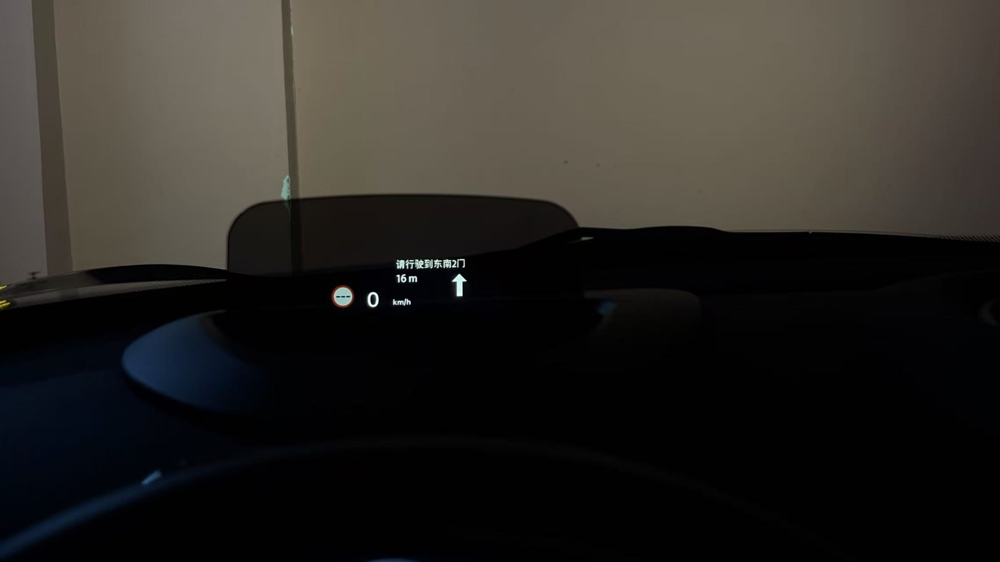
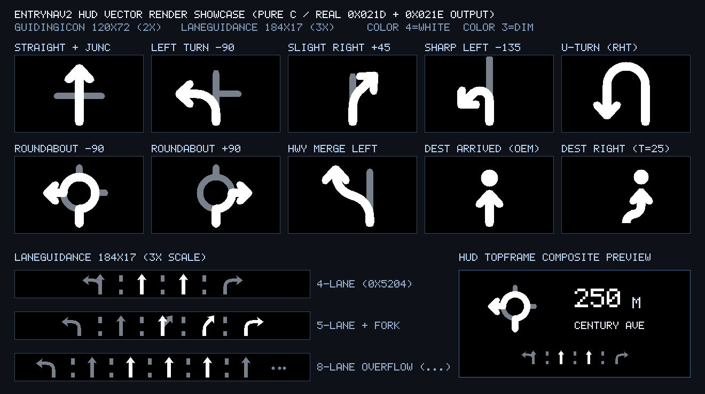

# EntryNav2 CarPlay → 原厂光学 MOST HUD 实时导航投射（`hud-port`）

**语言 / Language：** [简体中文](README.md) | [English](README.en.md)

> **如果这个项目对你有帮助或启发，欢迎点击右上角点个 Star ⭐ 支持一下！**
>
> **原创声明与非商业许可**：本项目全部纯 C 核心代码均由作者独立抓包分析与从零编写，仅允许个人学习、技术研究与非商业自用，**严禁用于任何商业用途**（详情见文末与 [LICENSE](LICENSE)）。

将 iPhone **CarPlay 实时导航引导（矢量转向/环岛/终点图标、出口角度与岔路、距离/单位、中文/英文路名、车道引导）** 实时投射到 **MINI / BMW EntryNav2** 主机的原厂光学风挡抬头显示（MOST `FBlock 0x82 / Inst 0x00` `HUDTerminal`）。

> 本仓库仅包含车机端纯 C 核心工程（`carplay-shim.so`、`hud_bridge`、`hud_probe`、`rgd_listen`、渲染器、单元测试与 systemd 部署模板），不含 Android 调试端 APK 与车机专有闭源库。

---

## 一、实车效果与矢量渲染预览

| 原厂光学 HUD 特写（中文路名 + 距离 + 箭头） | 中控 CarPlay 同步导航画面 | 驾驶位全景（HUD + 仪表 + 中控） |
| :---: | :---: | :---: |
|  |  |  |



*上图由 `hud_render.c` 真实输出的 `0x021D` 多边形与 `0x021E` 圆弧/圆点指令直接光栅化生成，无任何静态图片素材。*

---

## 二、核心原理与实现方案

本项目在协议与渲染上直接对齐 **Apple iAP2 Route Guidance 规范** 与 **EntryNav2 原厂库（`libNmeSDK.so` / `libVMostAdapter.so` / `libvmostclient.so.1` / `libvmostcpp.so.1`）**：

### 1. iAP2 协议注入与非阻塞捕获（`carplay-shim.so`）
- **组件声明与原生订阅**：通过 `LD_PRELOAD` 拦截 `/usr/local/bin/CARPLAY` 的 `NmeIAP2Message::Encode`，在 `0x1D01` (`IdentificationInformation`) 按 iAP2 规范顺序注入 `0x001E RouteGuidanceDisplayComponent`（`0x0000..0x0008`）以及 `0x0006` (`0x5200/0x5203`)、`0x0007` (`0x5201/0x5202/0x5204`)；在 `NmeIAP2Message::Decode` 收到 `0x1D02` 后由后台线程调用车机原生 `ICinemoIAP_StartRouteGuidanceUpdates` 激活手机端导航下发。
- **两段式解耦**：`CARPLAY` 进程受 `WatchdogSec=75` 监控，绝不可阻塞。`carplay-shim.so` 仅通过 **32 槽 × 4096B `pthread_mutex_trylock` 环形缓冲区** 将原始 `0x52xx` 报文异步发往 `/tmp/carplay_rgd.sock`，所有解析与总线通信由独立守护进程 `hud_bridge` 完成。

### 2. 原生光学 MOST HUD 矢量渲染（`hud_bridge` + `hud_render.c`）
直连 `/var/run/vmost_sockstream`（`MHP 0xF1/0x05`）与 `FBlock 0x82 / Inst 0x00` (`HUDTerminal`)，完整消费 `0x5201` / `0x5202` / `0x5204` 全字段并实时计算绘制：
- **自由角度矢量化与岔路上下文**：依据 `ExitAngle (-180°..+180°)` 连续旋转主路径，结合等半径圆弧倒角与 `Open V-Chevron` 开口箭头，并将 `JunctionElementAngles[]` 绘制为暗色（`HUD_COLOR_DIM = 3`）非行进岔路底图。
- **原生 `0x021E` 硬件圆弧与 `0x021D` 单块无缝多边形**：严格对齐原厂 `0x021E` 坐标系（`0 = 9 点钟顺时针`、`0.1°` 精度），用于环岛外环（`HUD_CIRCLE_FULL`）、高速变道与偏置终点的双切圆 **S 弯**（`HUD_CIRCLE_ARC`）及终点圆标（`HUD_CIRCLE_FILLED`）；掉头与环岛高亮路径合并为 **单块连续闭合多边形**（`0x021D`，实测稳定支持 38~58 顶点），消除拼接接缝。
- **原厂 `DestinationMan` 到达终点**：还原 `libVMostAdapter.so` 到达图形（`0x021E` 实心圆标 + 指向圆点的向上箭头），覆盖 `ManeuverType = 10/12/24/25/27` 与 `RouteState = 2 (Arrived)` 兜底（自动隐藏车道条并优先显示目的地名称）。
- **自适应多车道与 UTF-16BE 中文编码**：`1.LaneGuidance`（`184×17`）实时绘制 2~8 车道多方向组合箭头与高亮车道；路名编码遵循 `libvmostcpp.so.1.6.0` `writeMOSTString`（ASCII 用 `0x01`，含中文/非 ASCII 自动转为 `0x00` + **UTF-16 Big-Endian** + `0x0000`）。
- **会话守护**：`FNV-1a` 差异渲染 + 双缓冲 `SwitchVisibility (0x020E)`、15 秒长直路保活、`2500ms` 重算路防抖、遇原厂 `ErrorAck (0x0F)` 自动退让 5 秒。

---

## 三、数据流与工程结构

```text
┌───────────────────┐     iAP2 (0x1D01/0x1D02/0x5200..0x5204)     ┌──────────────────────────────┐
│   iPhone CarPlay  │ ──────────────────────────────────────────► │  /usr/local/bin/CARPLAY      │
│ (Apple地图/高德等) │ ◄────────────────────────────────────────── │  + LD_PRELOAD carplay-shim.so│
└───────────────────┘   0x1D01 注入 0x001E + 0x5200 StartRGD      └──────────────┬───────────────┘
                                                                                 │
                                           trylock 环形队列 + 后台线程            │ SOCK_DGRAM (非阻塞)
                                           /tmp/carplay_rgd.sock (chmod 0666)    ▼
┌───────────────────┐     MOST 0x82/0x00 + MHP (0xF1/0x05)        ┌──────────────────────────────┐
│ 原厂光学风挡 HUD   │ ◄────────────────────────────────────────── │  hud_bridge + hud_render.c   │
│ (FBlock 0x82/00)  │   /var/run/vmost_sockstream (libvmostclient)│  (状态机 + 矢量/圆弧渲染)     │
└───────────────────┘                                             └──────────────────────────────┘
```

```text
hud-port/
├── build.sh                          # 主机单测 + Zig ARMv7 交叉编译 + ABI 校验
├── docs/                             # 实车照片与渲染总览图
├── include/
│   ├── iap2_rgd.h                    # iAP2 0x1D01 / 0x5200..0x5204 TLV 常量与大端辅助
│   ├── vmost_api.h                   # libvmostclient.so.1 结构体与 0x82 HUDTerminal 功能码
│   └── hud_render.h                  # RgdState 状态机、矢量绘制指令与帧结构定义
├── src/
│   ├── carplay_shim.c                # CARPLAY 进程 LD_PRELOAD 非阻塞 iAP2 钩子
│   ├── hud_bridge.c                  # MHP/MOST 会话守护进程：双缓冲、保活与差异渲染
│   ├── hud_render.c                  # iAP2 状态机 + 矢量/0x021E圆弧渲染 + UTF-16BE 编码
│   ├── hud_probe.c                   # MOST 0x82/0x00 只读探测 / 8 秒独立画图自检工具
│   └── rgd_listen.c                  # /tmp/carplay_rgd.sock 实时抓包解码器（支持 --redact）
├── tests/test_hud_render.c           # 主机端单元测试（-Wall -Wextra -Werror）
└── systemd/                          # /run 临时注入与 /etc 持久化（3 次崩溃回退）模板
```

---

## 四、已验证车机平台与地图 App 兼容

| 项目 | 实车验证规格 |
|---|---|
| **车辆 / 主机** | 2021 MINI F56 JCW · **EntryNav2**（TI Jacinto 6 ARMv7 Cortex-A15 + NEON，固件 `202005181837`） |
| **系统 / ABI** | `Linux 3.12.25-FR21.0`，`eglibc 2.15`（兼容 `GLIBC_2.4` / `2.7`，`arm-linux-gnueabihf`） |
| **HUD 通道与画布** | MOST `FBlock 0x82 / Inst 0x00`：`TopFrame` + `Distance/Unit/ComingStreet` + `GuidingIcon (120×72)` + `LaneGuidance (184×17)` |
| **地图 App** | **Apple 地图**（全功能含 `0x5204` 车道）· **高德地图**（转向/距离/中文路名正常，App 暂不下发 `0x5204`）· **百度地图**（支持） |

---

## 五、交叉编译与车机部署

### 编译与单元测试
需安装 [Zig](https://ziglang.org/)（实测 `0.17.1`），并从车机 `/usr/local/lib/` 提取 `libvmostclient.so.1.6.0` 与 `libvmost.so.1.6.0`（仅本地链接，勿提交仓库）：

```bash
export RUNTIME_LIB=/path/to/entrynav2/usr/local/lib
./build.sh
```

### 车机部署
> **安全铁律**：**绝对不要在根分区 `/` 处于 `rw`（读写）状态时熄火断电！** 先用纯内存方案验证。

- **方案 A：纯内存临时测试（熄火/重启即恢复原厂）**

```sh
scp build/hud_bridge build/carplay-shim.so build/hud_probe build/rgd_listen root@169.254.1.0:/tmp/
chmod 0755 /tmp/hud_bridge /tmp/carplay-shim.so /tmp/hud_probe /tmp/rgd_listen
cp systemd/hud-bridge.service /run/systemd/system/hud-bridge.service
mkdir -p /run/systemd/system/CARPLAY.service.d
cp systemd/CARPLAY.service.d/hud-shim.conf /run/systemd/system/CARPLAY.service.d/hud-shim.conf
systemctl daemon-reload && systemctl start hud-bridge.service && systemctl restart CARPLAY.service
```

- **方案 B：受控持久化（开机自启）**
  `/var/local` 挂载含 `noexec`，不可运行二进制。需将产物放入 `/opt/hud-port/`，将 `systemd/hud-bridge-persist.service` 与自带 `/tmp/.hud_shim_tries` **3 次启动崩溃自动回退原厂 `CARPLAY`** 的 `hud-shim-persist.conf` 写入 `/etc/systemd/system/`，最后务必 `sync && mount -o remount,ro /` 确认回到只读。

---

## 六、原创版权声明与非商业开源许可

- **版权声明**：`Copyright (c) 2026 cerary. All rights reserved.`
- **原创性说明**：本仓库中的所有 C 语言源码均为作者基于实车抓包与二进制分析**独立原创编写**，不包含任何第三方源码或静态图片素材；链接所需的 `libvmostclient.so.1` 与 `libvmost.so.1` 为车机原厂系统库（本仓库不提供）。
- **开源许可协议**：本项目采用 **[PolyForm Noncommercial License 1.0.0](LICENSE)** 授权：
  - ✅ **允许**：个人学习、技术研究、代码审阅、自车非商业使用与非商业二次开发（须保留原作者版权声明与完整 `LICENSE`）。
  - ❌ **严禁商用**：禁止任何个人或商业机构将本项目源码或编译产物用于**任何商业用途**（包括收费刷机/安装、硬件/软件盒子打包售卖或商业集成）。

> **喜欢这个项目的话，别忘了点一个 Star ⭐，你的支持是持续维护和适配更多车型的最大动力！**
